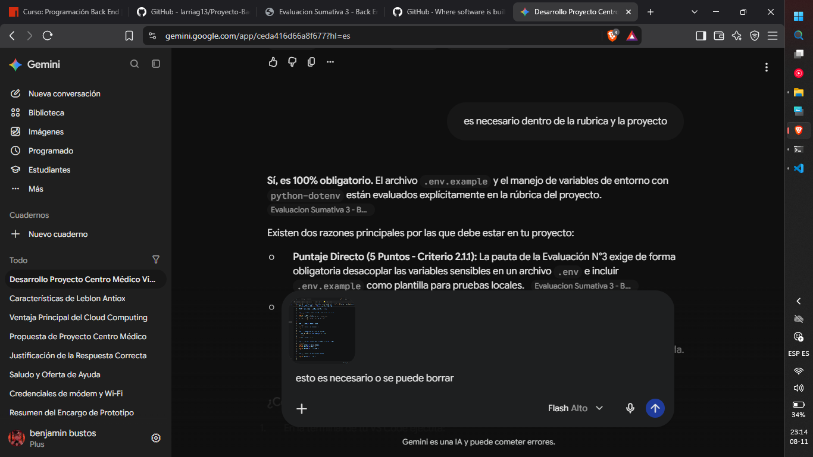

# Centro Médico Vitalis - Plataforma Web Back End

## Ficha de Registro y Aprobación de la Propuesta
Nombre de la Organización:** Centro Médico Vitalis
Modelo de Negocio / Giro:** Centro de Atención Médica Ambulatoria y Especialidades
Integrante: Benjamín Andres Bustos Esparza (RUT:21.980.235-8)
Entidad de Contexto / Agrupación (ORM):** `EspecialidadMedica`
Entidad Principal Gestionable (ORM):** `PrestacionMedica`
* **Propósito de la Sesión (request.session):** Canasta de Exámenes / Pre-agendamiento temporal de prestaciones de salud con desglose de copago y descuento por previsión (Fonasa/Isapre).

---

## Requisitos e Instalación Paso a Paso

### 1. Clonar el repositorio y crear entorno virtual
```bash
python -m venv .venv
source .venv/bin/activate  # En Linux/macOS
# .venv\Scripts\activate  # En Windows
```

### 2. Instalar dependencias
```bash
pip install -r requirements.txt
```

### 3. Configurar variables de entorno
Copiar el archivo `.env.example` a `.env`:
```bash
cp .env.example .env
```

### 4. Ejecutar migraciones y poblar datos iniciales
```bash
python manage.py makemigrations
python manage.py migrate
python manage.py poblar_datos
```

### 5. Iniciar servidor de desarrollo
```bash
python manage.py runserver
```

Acceder en el navegador a: `http://127.0.0.1:8000/`

---

## Credenciales de Prueba Creadas por `poblar_datos`
* **Administrador (Staff/Backoffice):**
  * Usuario: `admin`
  * Contraseña: `admin123`
* **Usuario Estándar (Paciente):**
  * Usuario: `paciente`
  * Contraseña: `paciente123`

---

## 🤖 Bitácora de Prompts de Inteligencia Artificial (Módulo 4.3)

### Caso 1: Arquitectura ORM y Validaciones Personalizadas
* **Prompt:** *"Necesito modelar dos entidades en Django ORM para un Centro Médico: EspecialidadMedica y PrestacionMedica. PrestacionMedica debe tener ForeignKey con PROTECT a EspecialidadMedica, validación de arancel no negativo, estado con choices y campo para baja lógica (is_active). Proporciona las clases de models.py y su formulario ModelForm con validación de código único."*
* **Respuesta IA:** Sugirió el uso de `MinValueValidator(0)` de `django.core.validators`, el parámetro `on_delete=models.PROTECT` en la FK, y el método `clean_codigo()` en `PrestacionForm`.
* **Adaptación Aplicada:** Se ajustaron los mensajes de error en español para Bootstrap 5 y se añadió la integración con el perfil extendido de usuario `PerfilUsuario` (RUT y teléfono).

### Caso 2: Optimización de Consultas SQL con `select_related`
* **Prompt:** *"¿Cómo optimizar el catálogo público en Django para evitar el problema N+1 queries al listar prestaciones médicas junto con su especialidad médica?"*
* **Respuesta IA:** Recomendó el uso de `PrestacionMedica.objects.select_related('especialidad').filter(is_active=True)` en la vista del catálogo público.
* **Adaptación Aplicada:** Se implementó `select_related` en `views.catalogo_prestaciones`, integrando filtros combinados con `Q` para búsqueda simultánea por código, nombre y descripción con paginación (`Paginator`).

### Caso 3: Manejo de Sesiones HTTP (`request.session`) y Seguridad por Roles
* **Prompt:** *"Escribe las funciones en Django views.py para manejar un carrito/canasta de exámen en request.session con subtotal, cálculo de descuento/copago por previsión y vista de resumen. Agrega decoradores para proteger rutas administrativas con is_staff."*
* **Respuesta IA:** Proporcionó la lógica para manipular el diccionario en `request.session['canasta']`, la función helper para desglosar importes y los decoradores `@login_required` junto a `@user_passes_test(lambda u: u.is_staff)`.
* **Adaptación Aplicada:** Se creó un Context Processor global en `context_processors.py` para proyectar la cantidad total de prestaciones en el Navbar en todas las pantallas del sistema.
